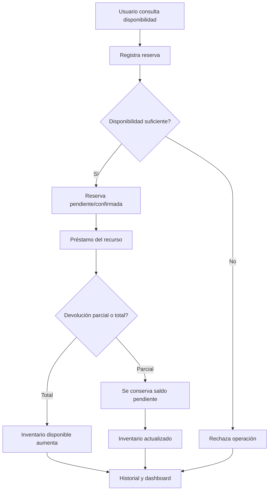

# Sistema de gestión de mesas y sillas

Este proyecto implementa una aplicación web para gestionar inventario, reservas, préstamos, devoluciones y historial de movimientos de mesas y sillas.

## 1. Arquitectura general

La solución se organiza en tres capas principales:

- Frontend: interfaz web responsive en HTML, CSS y JavaScript vanilla.
- Backend: API REST en Node.js + Express.
- Base de datos: PostgreSQL administrado en Neon, conectado con `DATABASE_URL`.

Las operaciones que cambian el inventario se ejecutan en transacciones y actualizan el inventario y el historial como una sola operación.

## 2. Entidades y relaciones de la base de datos

### Usuarios

- id
- name
- username
- password
- role
- created_at

### Recursos

- id
- resource_type
- name
- total_quantity
- available_quantity
- reserved_quantity
- borrowed_quantity
- returned_quantity
- status
- updated_at

### Reservas

- id
- user_id
- resource_type
- quantity
- reserved_date
- start_time
- end_time
- status
- observations
- created_at

### Préstamos

- id
- user_id
- resource_type
- quantity
- loan_date
- due_date
- status
- returned_quantity
- observations
- created_at

### Historial

- id
- user_id
- resource_type
- quantity
- operation_type
- state_before
- state_after
- details
- created_at

Relaciones:

- Un usuario tiene muchas reservas y préstamos.
- Un recurso se identifica por tipo: mesa o silla.
- Un historial registra cada operación ejecutada por el sistema.

## 3. Diagrama de flujo



## 4. Estructura de las API

### Autenticación

- POST /api/login
- POST /api/logout
- GET /api/me

### Inventario

- GET /api/resources
- POST /api/resources
- PUT /api/resources/:resource_type
- GET /api/dashboard

### Reservas

- GET /api/reservations
- POST /api/reservations
- PUT /api/reservations/:id/confirm
- PUT /api/reservations/:id/cancel

### Préstamos

- GET /api/loans
- POST /api/loans
- POST /api/loans/:id/return

### PayPal Sandbox (demostración)

- GET /api/paypal/config
- POST /api/paypal/orders

La sección **Pago demo** crea órdenes únicamente con la API de PayPal Sandbox. El comprador de prueba puede aprobar una orden, pero la aplicación no incluye una operación para capturarla; por eso no se transfiere ni se cobra dinero. No uses credenciales de producción.

### Historial

- GET /api/history

## 5. Roles y permisos

### Administrador

- Gestiona inventario.
- Confirma y cancela reservas.
- Registra devoluciones de cualquier préstamo.
- Consulta histórico y dashboard.
- Gestiona usuarios.

### Usuario estándar

- Consulta disponibilidad.
- Registra reservas.
- Consulta y cancela sus reservas.
- Consulta sus préstamos y registra devoluciones propias.
- Consulta devolución estimada.

## 6. Reglas de negocio

- No se puede reservar más de la disponibilidad actual.
- No se puede prestar inventario reservado; el préstamo solo consume unidades disponibles.
- No se pueden devolver cantidades mayores a la cantidad pendiente.
- La cantidad disponible no puede ser negativa.
- Cada operación genera un registro en el historial.
- Cuando un préstamo se devuelve parcialmente, se mantiene el saldo pendiente como préstamo activo.

## 7. Estructura de carpetas del proyecto

```text
.
├── public/
│   ├── app.js
│   ├── index.html
│   └── styles.css
├── src/
│   ├── db.js
│   ├── neonPool.js
│   ├── passwords.js
│   └── seed.js
├── scripts/
│   └── migrate-sqlite-to-neon.js
├── .gitignore
├── package.json
├── README.md
├── server.js
└──
```

## 8. Cómo ejecutar

1. Instala dependencias:

```bash
npm install
```

2. Configura las variables de entorno en `.env`:

```dotenv
DATABASE_URL=postgresql://...
JWT_SECRET=una-clave-aleatoria-de-al-menos-32-caracteres
INITIAL_ADMIN_PASSWORD=clave-inicial-larga-y-unica
PAYPAL_SANDBOX_CLIENT_ID=client-id-de-prueba
PAYPAL_SANDBOX_CLIENT_SECRET=client-secret-de-prueba
# Opcional: orígenes web externos autorizados, separados por comas
CORS_ORIGIN=https://ejemplo.com
```

Obtén las credenciales creando una aplicación REST en **PayPal Developer > Sandbox**; configura aquí el Client ID y Secret de Sandbox, nunca los de producción. Para probar la aprobación, usa una cuenta compradora Sandbox. No subas `.env` al repositorio. En producción, `JWT_SECRET` es obligatorio.

## 9. Despliegue en Vercel

El proyecto incluye configuración para ejecutar Express como una función de Vercel y servir la interfaz y la API desde el mismo dominio.

1. Ejecuta `npm run deploy:vercel`. El asistente inicia sesión en Vercel y enlaza el proyecto; completa las preguntas de la CLI.
2. En el dashboard de Vercel, abre **Settings → Environment Variables** y configura para **Production**:
   - `DATABASE_URL`: URL de conexión a PostgreSQL/Neon.
   - `JWT_SECRET`: secreto aleatorio de al menos 32 caracteres.
   - `INITIAL_ADMIN_PASSWORD`: contraseña inicial de al menos 12 caracteres, necesaria solo si la base de datos todavía no tiene usuarios.
   - `PAYPAL_SANDBOX_CLIENT_ID` y `PAYPAL_SANDBOX_CLIENT_SECRET`: credenciales de una aplicación **Sandbox**, nunca de producción.
3. Si agregaste `INITIAL_ADMIN_PASSWORD`, vuelve a la terminal y confirma el despliegue cuando el asistente lo solicite. También puedes configurar las variables con `vercel env add NOMBRE production`; la CLI pedirá el valor sin incluirlo en el código del proyecto.
4. Comprueba `https://TU-DOMINIO/api/health`; debe responder `{"ok":true,"database":"connected"}`.

No incluyas secretos en el repositorio ni en archivos versionados. Si Vercel muestra que ya existe una variable, conserva su valor desde el dashboard en lugar de volver a crearla.
La API servida desde este mismo sitio no requiere configurar CORS; por defecto no se autorizan orígenes externos.
`INITIAL_ADMIN_PASSWORD` solo se usa si la base está vacía en el primer arranque de producción; debe tener al menos 12 caracteres. El servidor no crea cuentas con contraseñas de demostración en producción.

3. Inicia la aplicación:

```bash
npm start
```

4. Abre la app en el navegador:

```text
http://localhost:3000
```

Credenciales de desarrollo (solo cuando se inicializa una base vacía fuera de producción):

- Administrador: admin / admin123
- Usuario: usuario / usuario123

Las contraseñas se guardan con hash scrypt; las contraseñas de instalaciones anteriores se actualizan al iniciar sesión correctamente. Cambia las credenciales de demostración si el sitio se publica.

## Migrar la base local a Neon

Si existe `data/app.db`, primero revisa el resultado de una simulación:

```bash
npm run migrate:sqlite
```

La simulación es de solo lectura para Neon. Para aplicar la migración, importar operaciones locales faltantes, conservar los usuarios y recursos existentes en Neon y recalcular el inventario desde reservas/préstamos activos:

```bash
npm run migrate:sqlite:apply
```

La migración se ejecuta en una transacción, evita importar dos veces los mismos registros y registra su ejecución en Neon.

## 9. Estado del proyecto

Ejecuta las pruebas del backend con:

```bash
npm test
```

La aplicación incluye:

- Inventario de mesas y sillas
- Reservas con validación de cantidades
- Préstamos y devoluciones parciales
- Dashboard con indicadores clave
- Historial de movimientos
- Autenticación básica por roles
- Interfaz responsive

## 10. Fuente única del inventario

La lógica centralizada dentro del modelo de base de datos asegura que las cantidades de disponible, reservada y prestada siempre se recalculen a partir del número total del recurso y de la operación ejecutada.

Esto evita inconsistencias y permite un seguimiento claro del flujo real de uso del inventario.
